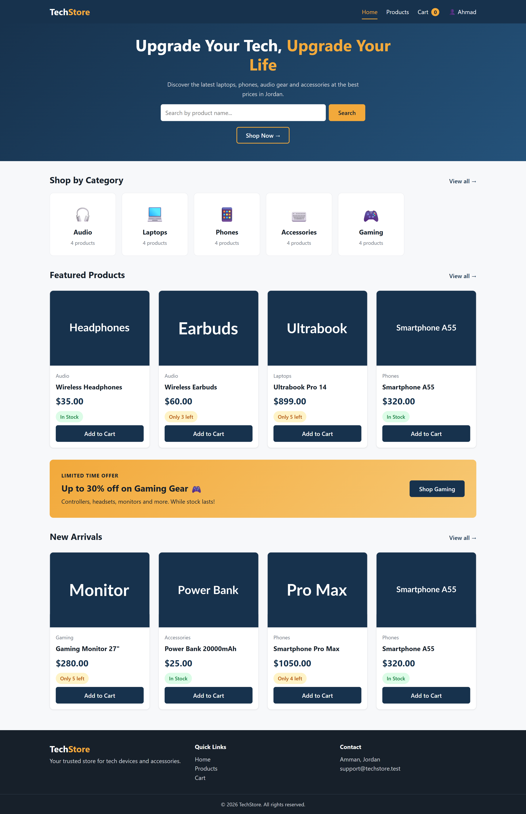
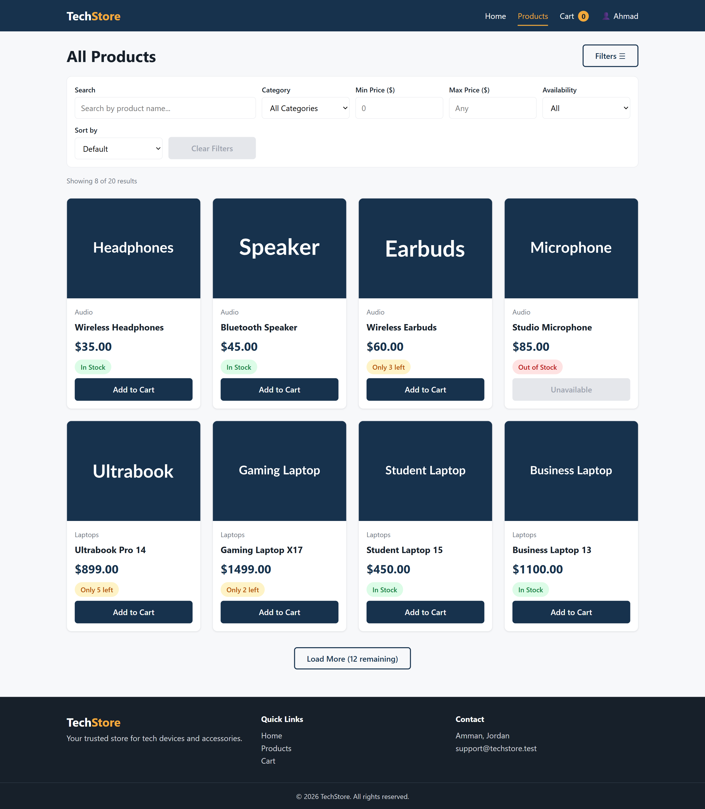
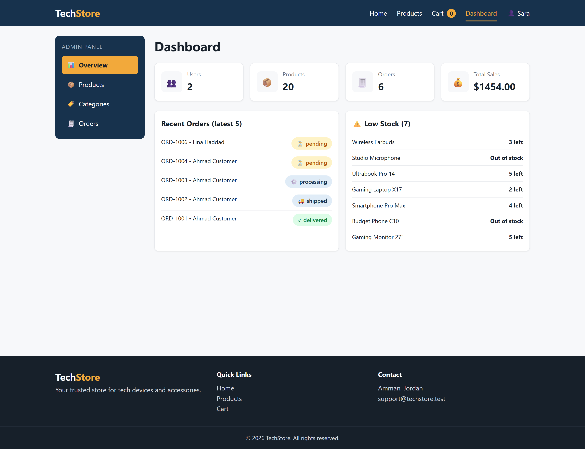
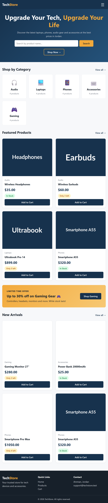
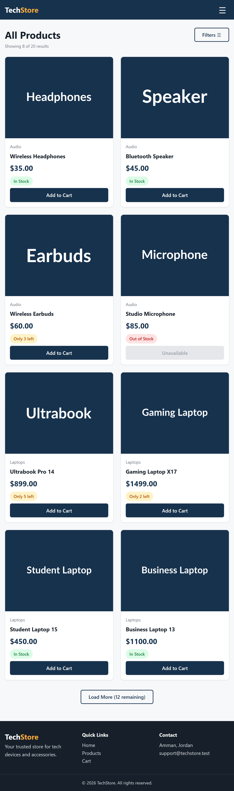
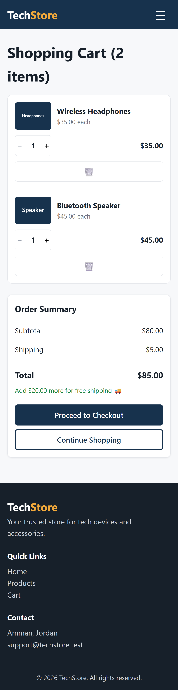
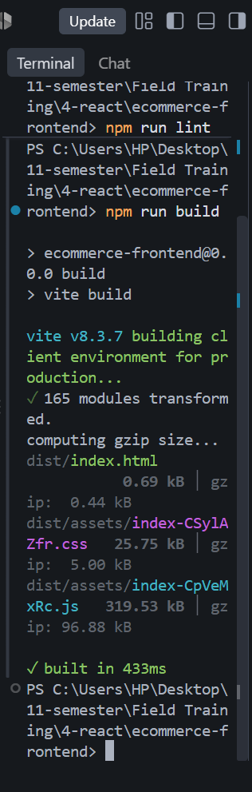

# 🛒 TechStore — E-commerce Frontend

A responsive e-commerce frontend for a tech store (laptops, phones, audio, accessories and gaming), built with **React**, **Vite** and **React Router**.

The project includes a customer storefront (browse, search, filter, cart, checkout, account) and an admin dashboard (stats, products, categories and orders management).

> ⚠️ **This project uses Mock Data only.** All products, users and orders come from local files in `src/data/`. It is **not** connected to the REST API or the Neon database yet — this will be done in the next task.

🔗 **Live Preview:** [YOUR-VERCEL-LINK-HERE](YOUR-VERCEL-LINK-HERE)

---

## 🧰 Tools & Libraries

| Tool                | Usage                                          |
| ------------------- | ---------------------------------------------- |
| React               | Building the UI with components and state      |
| Vite                | Project setup, dev server and production build |
| React Router        | Client-side routing between pages              |
| Context API         | Shared state for cart, auth and notifications  |
| CSS + CSS Variables | Styling and design system (no UI library)      |
| Local Storage       | Persisting the cart and the logged-in user     |
| ESLint              | Code quality checks                            |
| Vercel              | Deployment (Preview link)                      |

---

## ⚙️ Requirements

- Node.js **20.19+** (or 22+)
- npm

---

## 🚀 Getting Started

```bash
# 1. Clone the repository
git clone https://github.com/odehtareq/ecommerce-frontend.git
cd ecommerce-frontend

# 2. Install dependencies
npm install

# 3. Run the development server
npm run dev

# 4. Build for production
npm run build

# 5. Preview the production build locally
npm run preview

# 6. Check code quality
npm run lint
```

---

## 📁 Folder Structure

```
ecommerce-frontend/
├── public/
├── screenshots/            # App screenshots (desktop, tablet, mobile)
├── src/
│   ├── assets/
│   ├── components/
│   │   ├── admin/          # AdminSidebar, StatCard, AdminProducts, ProductForm, AdminCategories, AdminOrders
│   │   ├── cart/           # CartItem, QuantitySelector
│   │   ├── common/         # Modal, ConfirmDialog, EmptyState, SearchBar, ProtectedRoute, Toast styles
│   │   ├── forms/          # FormField, PasswordField
│   │   ├── home/           # HeroSection, PromoBanner
│   │   ├── layout/         # Layout, Navbar, Footer
│   │   └── products/       # ProductCard, ProductDetails, CategoryCard, ProductCardSkeleton
│   ├── context/            # CartContext, AuthContext, ToastContext + Providers
│   ├── data/               # Mock data: products, categories, users, orders
│   ├── hooks/              # useCart, useAuth, useToast, useSimulatedFetch
│   ├── pages/              # One file per page
│   ├── styles/             # Global styles, design system variables and page styles
│   ├── utils/              # helpers (price, stock, shipping) and validation
│   ├── App.jsx             # Routes
│   └── main.jsx            # App entry + providers
├── vercel.json             # SPA rewrites (routes work after refresh)
└── package.json
```

---

## 🗺️ Pages & Routes

| Route           | Page                                                                   | Access             |
| --------------- | ---------------------------------------------------------------------- | ------------------ |
| `/`             | Home: hero, search, categories, featured, promo, new arrivals          | Public             |
| `/products`     | Products: search, filter (category, price, stock), sort, load more     | Public             |
| `/products/:id` | Product details: stock status, quantity, add to cart, similar products | Public             |
| `/cart`         | Shopping cart: quantities, remove with confirmation, totals            | Public             |
| `/checkout`     | Checkout: shipping form, payment method, order confirmation            | Public             |
| `/login`        | Login with validation and show/hide password                           | Public             |
| `/register`     | Register with password confirmation and terms agreement                | Public             |
| `/profile`      | User info, edit profile, change password, order history                | 🔒 Logged-in users |
| `/admin`        | Admin dashboard: stats, products, categories, orders                   | 🔒 Admin only      |
| `*`             | 404 Not Found                                                          | Public             |

---

## 🧩 Main Components

| Component                     | Purpose                                                  |
| ----------------------------- | -------------------------------------------------------- |
| `Navbar` / `Footer`           | Shared layout on all pages, mobile menu, cart count      |
| `ProductCard`                 | Image, name, price, stock status and add-to-cart action  |
| `CategoryCard`                | Shows a category and links to filtered products          |
| `FormField` / `PasswordField` | Unified labels, inputs and error messages                |
| `Modal` / `ConfirmDialog`     | Dialogs and confirmations (closable with Esc)            |
| `EmptyState`                  | Empty cart, no results, no orders, errors                |
| `ProductCardSkeleton`         | Loading state while data is "fetched"                    |
| `QuantitySelector`            | Quantity control limited by stock                        |
| `ProtectedRoute`              | Protects `/profile` and `/admin` based on login and role |
| `AdminSidebar`                | Navigation inside the admin dashboard                    |

---

## 👤 Demo Accounts

> These are **fake test accounts** for demo purposes only — no real secrets.

| Role     | Email                     | Password      |
| -------- | ------------------------- | ------------- |
| Customer | `customer@techstore.test` | `Customer123` |
| Admin    | `admin@techstore.test`    | `Admin123`    |

New accounts can also be created from the Register page (saved in the browser's Local Storage).

---

## ✨ Features

- 🛒 Cart shared with **Context API** and saved in **Local Storage** (survives refresh)
- 🔢 Totals are **derived** from cart items (never stored separately)
- 🚫 Quantity can never exceed available stock
- 🔍 Case-insensitive search, filters, sorting and "Load More"
- ✅ Form validation with clear error messages
- 🔐 Simulated login with customer/admin roles and protected routes
- ⏳ Loading (skeleton), Error (with retry), Empty, Success, Unauthorized and 404 states
  - Test the error state: open `/products?simulateError=true`
- 📱 Responsive on Desktop (1440px), Tablet (768px) and Mobile (390px)
- ♿ Accessibility: semantic HTML, labels, alt text, visible focus, skip link, keyboard-closable modals

---

## 📸 Screenshots

### Desktop





### Tablet




### Mobile





### Build



---

## 🔌 Next Step: Connecting to the API

This frontend is ready to be connected to the REST API (Node.js + Express + Neon) in the next task:

- Replace the mock files in `src/data/` with real `fetch` calls to the API
- Replace `useSimulatedFetch` with real loading/error handling
- Replace the simulated `login` / `register` in `AuthProvider` with API requests (JWT)
- Save real orders from Checkout to the database
- Move admin changes (products, categories, order status) from local state to API requests
